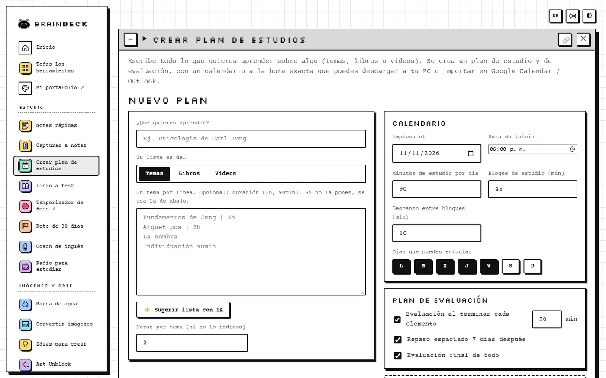
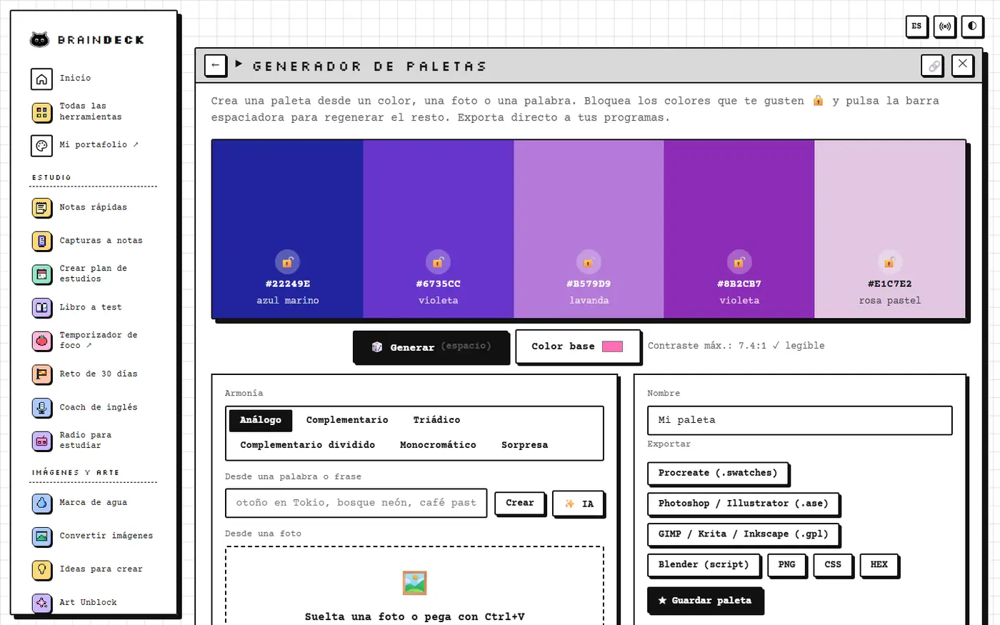
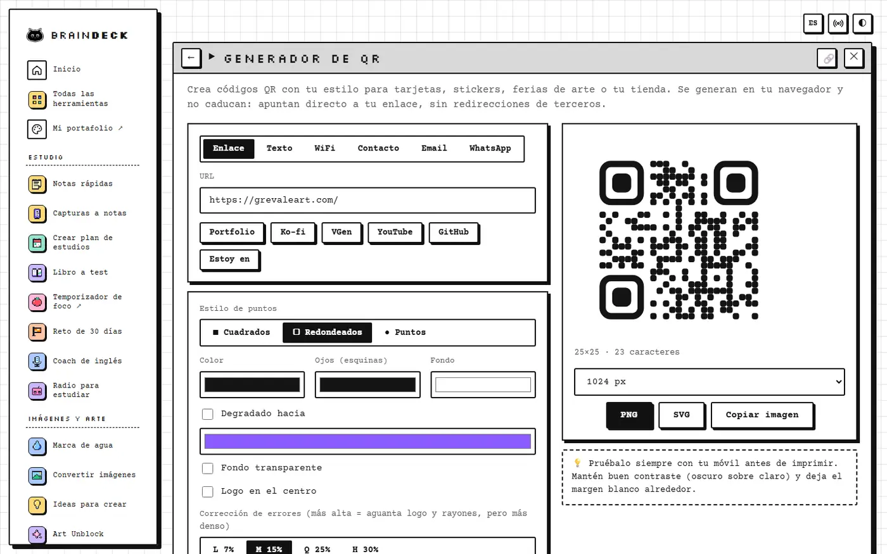

Si dibujas, estudias por tu cuenta o simplemente eres de las personas que siempre tiene diez pestañas abiertas, seguramente conoces el ritual: una web para comprimir una imagen, otra para quitarle el fondo, otra para unir dos PDFs, una app de pago para hacer paletas y alguna página llena de anuncios para generar un QR. Cada una con su propio límite, su propio registro y, muchas veces, subiendo tus archivos a un servidor que no tienes idea de dónde está.

BrainDeck nació de ese cansancio. Es una mesa de trabajo web que junta más de 20 herramientas para artistas, autodidactas y creativos en un solo lugar, y que funciona entera dentro del navegador. No hay backend, no hay cuentas y no hay nada que instalar.

## Qué problema resuelve

La idea de fondo es sencilla: las tareas pequeñas del día a día creativo no deberían costarte tu privacidad ni una suscripción. Cuando comprimes una foto en BrainDeck, la foto no sale de tu computadora. Cuando conviertes un PDF en un test de estudio, el libro se procesa en tu dispositivo. Todo se guarda en el propio navegador, y si quieres llevarte tus datos a otro lado puedes exportar una copia, incluso cifrada con contraseña.

Las herramientas están agrupadas en estudio, imágenes y arte, utilidades y dinero. En la parte de estudio hay un generador de planes de estudio que convierte una lista de temas, libros o videos en un calendario `.ics` que puedes importar a tu agenda, una herramienta que transforma un libro en un test con repaso espaciado, retos de 30 días para dibujo, piano, 3D o idiomas, y una que toma capturas de pantalla, separa el texto importante de la interfaz y lo convierte en notas. También hay un coach de inglés hablado: te grabas, Whisper transcribe y te devuelve correcciones de gramática, vocabulario y fluidez.

El lado artístico tiene lo que más se repite cuando publicas tu trabajo en internet. Marca de agua en lote con metadatos de autor y una señal para pedir que tus imágenes no se usen para entrenar IA, compresión hasta un peso exacto en KB (que además borra los datos ocultos como el GPS), un quitador de fondo que corre en el navegador, un generador de paletas que exporta a Procreate, Adobe, Krita, Blender y CSS, y sesiones de gesture drawing con poses cronometradas. Cuando el bloqueo creativo aparece, Art Unblock te lanza frases surrealistas para destrabarte.

Y luego están las utilidades que uno siempre termina buscando en Google: unir y editar PDFs, generar subtítulos SRT y VTT, crear códigos QR con estilo, un buscador de atajos de teclado para Photoshop, Krita, Blender, Figma o VS Code, y una calculadora de comisiones para quienes vendemos arte y nunca sabemos cuánto cobrar para recibir lo que queremos.

## IA opcional, y que corre en tu equipo

Me importaba mucho que la inteligencia artificial fuera una opción y no un requisito. BrainDeck tiene tres niveles: sin IA, usando OCR y heurísticas locales; con IA local, usando modelos como Whisper, Gemini Nano o Qwen que se ejecutan en el propio navegador gracias a WebGPU; y con Claude, solo si tú pones tu propia API key. En ese último caso, lo único que sale de tu equipo es lo que decides enviar.

La API key nunca se exporta en las copias de seguridad y puedes usarla solo durante la sesión, de modo que se olvide al cerrar la pestaña.

## Hecha para que se sienta tuya

No quería otra herramienta gris y funcional. El inicio es un dashboard con avatar, nivel, experiencia, racha en corazones y una bolsa de objetos pixel que se desbloquean con el uso, un poco en la línea de lo que hice con [FOCUS TIME](/posts/focus-time-app-productividad-tdah/), que de hecho está integrada como temporizador de foco. Hay cuatro estilos visuales (Paper, Neo pixel, Cosmos y Frost), una radio para estudiar con ruidos de colores, lluvia, chimenea y emisoras de lofi o vaporwave, y puedes reordenar las herramientas arrastrándolas. Está en español y en inglés, y se puede instalar como app para abrirla incluso sin conexión.

Por dentro es HTML, CSS y JavaScript sin compilación. Cada librería pesada se carga solo cuando la necesitas, hay una política de seguridad de contenido estricta y cada script externo se verifica con su huella SHA-384, así que si un CDN lo modificara, el navegador simplemente no lo ejecuta.

## Pruébala o mejórala

BrainDeck es gratis y open source. Puedes usarla directamente en [mybraindeck.netlify.app](https://mybraindeck.netlify.app/), clonarla para tenerla en local o publicarla tú en GitHub Pages o Netlify tal cual, sin configurar nada. Si se te ocurre una herramienta que falte, añadir una nueva es cuestión de un archivo de JavaScript.

El código está en GitHub: [GVPV12/braindeck](https://github.com/GVPV12/braindeck). Si la usas, me encantaría saber qué herramienta terminó siendo tu favorita.
