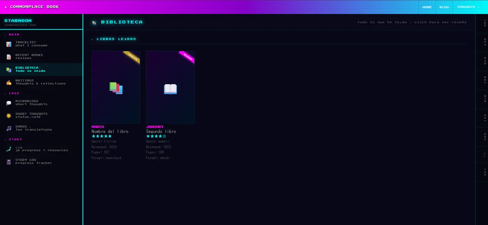
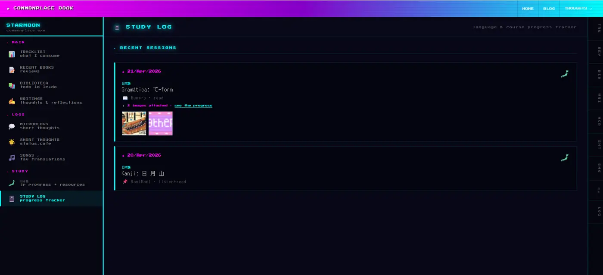

Un commonplace book es, en esencia, un cuaderno donde vas guardando lo que te llama la atención: citas, ideas, libros que leíste, cosas que quieres recordar. Durante siglos fue de papel. Hoy, casi todo eso lo dejamos repartido entre Goodreads, Letterboxd, Backloggd, notas del celular y alguna red social que, de paso, usa esa información para venderte cosas.

Yo quería tenerlo todo en un solo sitio y que fuera mío. Por eso hice este commonplace book digital: un tracker y cuaderno personal para registrar los libros, juegos, películas y demás cosas que consumo, junto con lo que pienso de ellas. Lo puedes usar en local o subir a tu propia web personal, donde controlas tus datos de principio a fin. También me sirve para algo que me importa cada vez más, que es [consumir de forma más consciente](/consumir-conscientemente/).

## Cómo funciona

Está hecho con HTML, CSS y JavaScript sin frameworks ni herramientas de compilación, con una estética vaporwave inspirada en sistemas operativos retro. Todo el contenido vive en archivos JSON: cada pestaña del cuaderno lee el suyo, así que para añadir un libro o un juego solo tienes que editar el archivo correspondiente y subirlo.

La pestaña de seguimiento muestra lo que estás leyendo, jugando, viendo o escuchando en este momento, con una barra de progreso y una frase corta sobre por qué te tiene enganchado. La biblioteca guarda cada libro terminado con una reseña completa: puntuación general y por apartados (escritura, personajes, trama, final), una cita favorita y tus pensamientos. Hay también un espacio para escritos propios como poemas, relatos o reflexiones, otro para canciones con su traducción y su significado, microblogs con barras de estado de ánimo y un registro de estudio para idiomas o cursos, con una pestaña filtrada solo para japonés.

Dos partes se alimentan solas. Los libros recientes se leen del RSS público de Goodreads, y los pensamientos cortos salen de status.cafe, una especie de Twitter retro y mucho más tranquilo, mediante un pequeño script que genera el JSON.

## Por qué JSON y no una base de datos

Podría haberlo hecho con una base de datos y un panel de administración, pero eso lo habría convertido en algo que hay que mantener. Con archivos JSON, el cuaderno se puede subir a cualquier hosting estático como Nekoweb o Neocities, se puede guardar en una carpeta para siempre y se puede leer incluso sin la web. Si algún día dejo de usarlo, mis datos siguen ahí, en texto plano.

Una cosa que me quedó pendiente es importar automáticamente desde Backloggd. Intenté sacar los datos con un script y no funcionó, así que si alguien quiere implementarlo, la ayuda es más que bienvenida.

## Llévatelo a tu web

Puedes ver el mío en vivo en [starmoon.nekoweb.org](https://starmoon.nekoweb.org/commonplace_book.html). Para hacer el tuyo, clonas el repositorio, cambias los JSON por tus datos, pones tu ID de Goodreads y lo subes a tu hosting. Los colores se cambian desde unas pocas variables CSS, y añadir o quitar pestañas es cuestión de duplicar o borrar un bloque.

Es open source y lo puedes usar como base para tu propio commonplace book. Si lo haces, un enlace de vuelta a mi web se agradece, pero no es obligatorio.

El código está en GitHub: [GVPV12/commonplacebook](https://github.com/GVPV12/commonplacebook).
