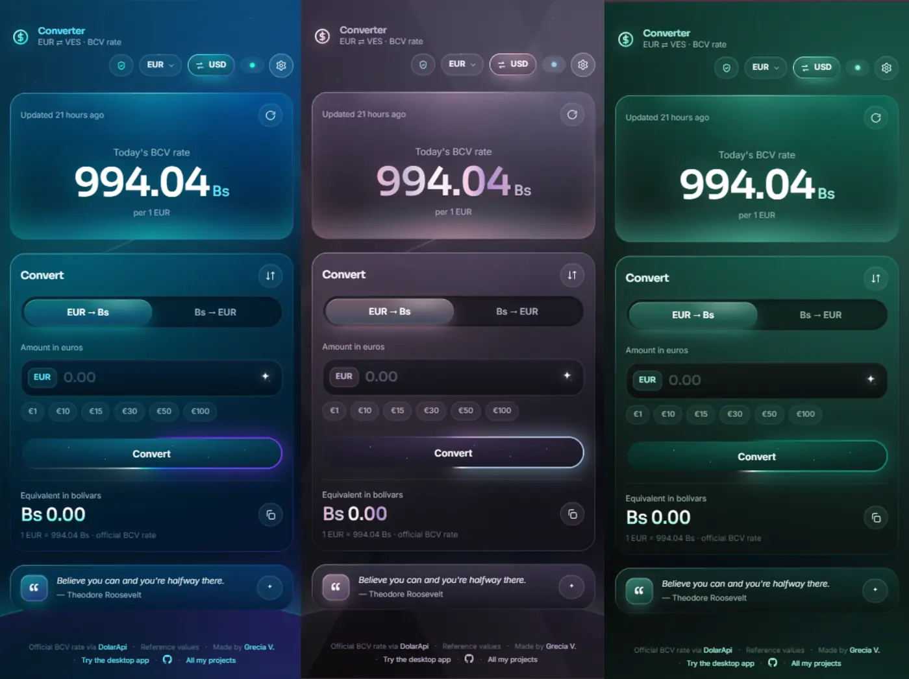

En Venezuela casi todo pasa por una cuenta mental: cuánto es esto en bolívares, cuánto era ayer, si la tasa ya cambió. Para hacer esa conversión con la tasa oficial del Banco Central de Venezuela lo normal es entrar a la web del BCV, buscar el número del día y sacar la cuenta con la calculadora del teléfono. Funciona, pero es lento, y la página del BCV no siempre carga cuando más la necesitas.

El Convertidor BCV es mi respuesta a eso. Es una web que convierte dólares y euros a bolívares, y bolívares a dólares y euros, en vivo mientras escribes, usando la tasa oficial del BCV. Empezó como una app en Python con Kivy y la terminé llevando a la web para poder abrirla desde cualquier lado sin instalar nada.

## Cómo se mantiene al día sola

La parte de la que más me gusta hablar es la que no se ve. Cada 30 minutos, una GitHub Action lee la portada de bcv.org.ve, toma la tasa del dólar y del euro con su fecha valor y, si algo cambió, guarda el resultado en un archivo y hace un commit. Netlify publica ese cambio automáticamente. Así, cuando el BCV publica la tasa nueva por la tarde, el convertidor la muestra casi enseguida, sin que yo tenga que tocar nada.

Como leer una web ajena siempre tiene sus riesgos, el script rechaza cualquier tasa que salte más de un 25 % respecto a la anterior. Es una red de seguridad sencilla para que un error de lectura no termine mostrándole a alguien un precio absurdo. Además, la web consulta también DolarApi como respaldo, y si te quedas sin conexión te muestra la última tasa que guardó.

## Más que una calculadora

Además de convertir, la página enseña la tasa de hoy con una gráfica histórica de 7, 30 o 90 días y su variación porcentual, para entender si el dólar viene subiendo o se está quedando quieto. Hay un botón para pasar del dólar al euro, otro opcional que te lleva a la página oficial del BCV para verificar la cifra, y una vista simple que deja solo el precio cuando no quieres ver nada más.

Como tampoco quería que fuera una herramienta fría, cada visita muestra una frase de esperanza distinta, y tiene tres skins (Fluido, Holograma y Esmeralda) que puedes fijar o dejar que roten. Está en español y en inglés, se adapta a teléfono, tablet o monitor grande, y recuerda tus preferencias la próxima vez que entres. Mi recomendación es guardarla en la pantalla de inicio del teléfono y usarla como si fuera una app.

Por dentro no tiene nada complicado: HTML, CSS y JavaScript sin frameworks de compilación, Tailwind para el layout y un script de Node sin dependencias para leer la tasa.

## Úsala o adáptala

El convertidor es gratis y open source. Lo puedes usar en [usdbcv.netlify.app](https://usdbcv.netlify.app/) o abrir el `index.html` directamente en tu navegador. Si quieres adaptarlo a otra moneda o a otro banco central, la lógica de lectura está separada en un solo script.

El código está en GitHub: [GVPV12/convertidor-bcv-web](https://github.com/GVPV12/convertidor-bcv-web).
