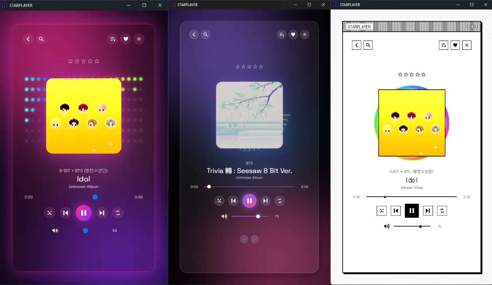
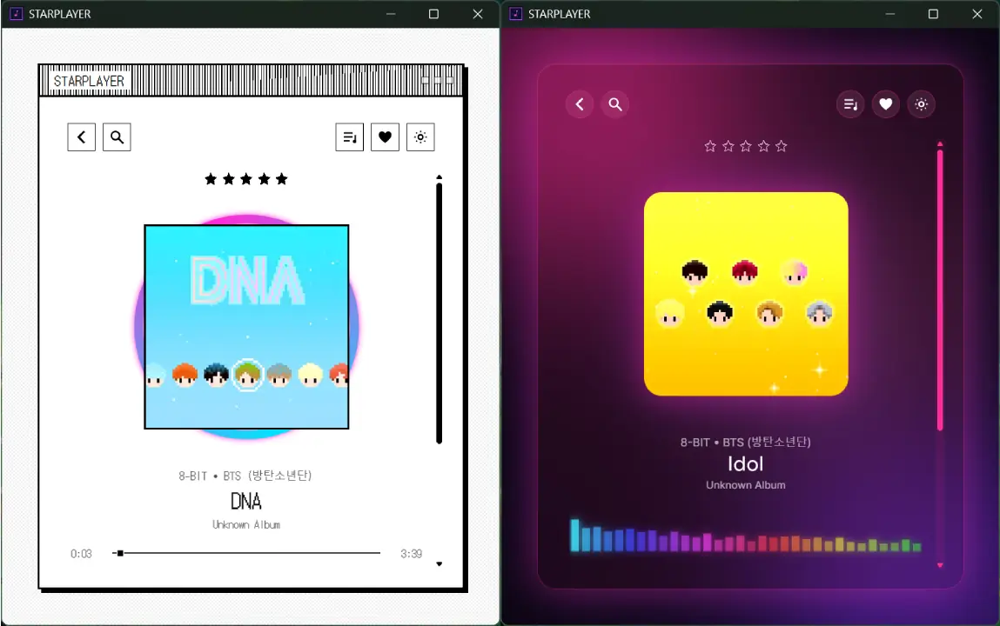

Tener tu música en archivos se volvió casi un acto de resistencia. La mayoría de reproductores que quedan para escuchar una biblioteca local o están abandonados, o están llenos de anuncios, o intentan empujarte a un servicio de streaming. Y si además te gusta que las cosas se vean bonitas, las opciones se reducen todavía más.

STARPLAYER es el reproductor que quería tener. Es una aplicación de escritorio, gratis y sin anuncios, para escuchar tu propia música con privacidad y con muchísimas opciones de personalización. Su identidad es la de un simulador de sistema operativo retro con estética vaporwave: ventanas pixeladas, fuentes bitmap gruesas y brillos de neón.

## Tu biblioteca, en tu equipo

Al abrirlo por primera vez eliges la carpeta donde guardas tu música. STARPLAYER la recorre completa buscando archivos mp3, flac, wav, m4a y ogg, lee las etiquetas que traen dentro y lo guarda todo en una base de datos SQLite local. No hay cuentas, no hay sincronización con servidores y nada de lo que escuchas sale de tu computadora.

Encima de eso tienes playlists, calificaciones con estrellas y un clasificador de ánimo que usa el BPM de cada canción. Ese último dato se conecta con una de las partes más divertidas del proyecto.

## Un motor de skins de verdad

STARPLAYER trae cinco skins: Vaporwave, que es la predeterminada, Neo-Brutalist Cute, Gradient Glass, Monochrome Retro y Soft Glass, además de un constructor para crear la tuya. La gracia está en cómo funcionan: ningún componente tiene colores ni fuentes fijos, todo se lee de variables CSS, así que cambiar de skin es instantáneo y cambia la apariencia completa, desde el control de volumen hasta las estrellas de calificación.

Puedes elegir la skin a mano, dejar que salga una al azar cada vez que abres el programa, o activar el modo que se adapta al ritmo, que cambia de skin según el ánimo calculado de la canción que suena. Esa relación entre ánimo y skin también se puede editar.

Un detalle que quizá no se nota: las fuentes pixel que imaginé al principio no se pueden redistribuir libremente, así que el reproductor usa alternativas con licencia libre que se ven casi igual. Si tienes la licencia de las originales, basta con poner los archivos en una carpeta.

## Cómo está hecho

Usa Tauri 2 con React y TypeScript, lo que lo hace mucho más ligero que una app de Electron. El proyecto está organizado como un monorepo con un paquete central de lógica compartida (reglas de calificación, consultas de playlists, curva de volumen, clasificador de ánimo y tokens de skins), otro de componentes de interfaz y otro de recursos. La versión móvil existe por ahora solo como espacio reservado.

Algo que debes saber antes de descargarlo: Windows Defender o Smart App Control pueden marcarlo como aplicación desconocida. No es porque tenga nada raro, sino porque no está firmado con un certificado de código, que cuesta dinero y no tiene mucho sentido para un proyecto pequeño y sin fines comerciales. Si lo descargas desde el repositorio oficial, puedes revisar los archivos y decidir si confías en él.

## Descárgalo o contribuye

STARPLAYER es gratis y open source. Puedes descargar la última versión desde la [página de releases](https://github.com/GVPV12/STARPLAYER/releases/) o compilarlo por tu cuenta con pnpm y Rust siguiendo las instrucciones del README.

El código está en GitHub: [GVPV12/STARPLAYER](https://github.com/GVPV12/STARPLAYER).
